# Colorbitz

[](https://github.com/matheusmontagner8/colorbitz/actions/workflows/tests.yml)

Puzzle casual com visual **neon** para celular, feito em **Godot 4** com **GDScript**.
Toque em grupos de blocos da mesma cor para estourá-los e cumpra a meta da fase
antes de acabarem as jogadas.

<p align="center">
  
  
  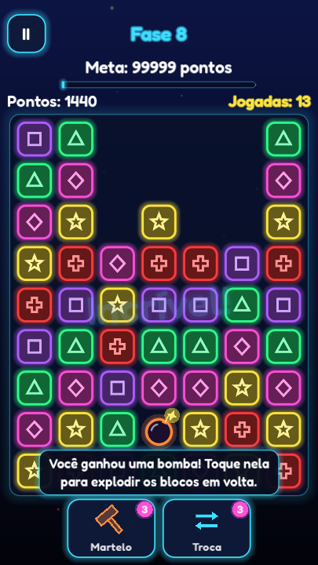
  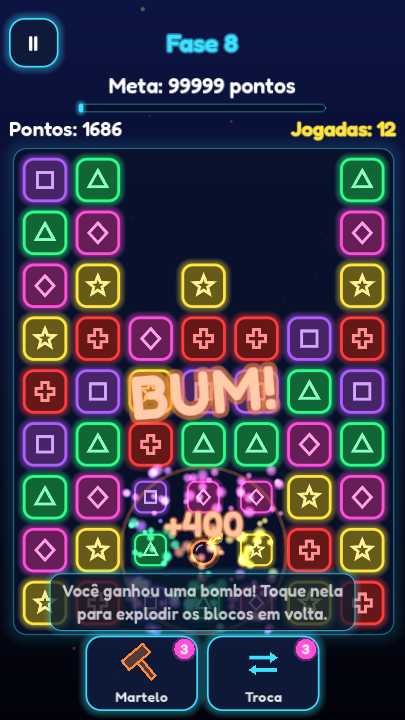
  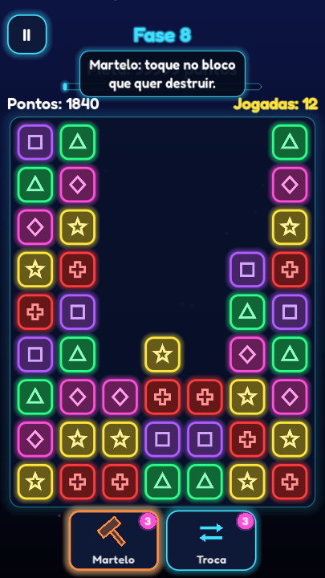
  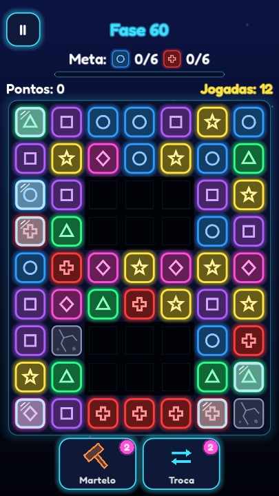
  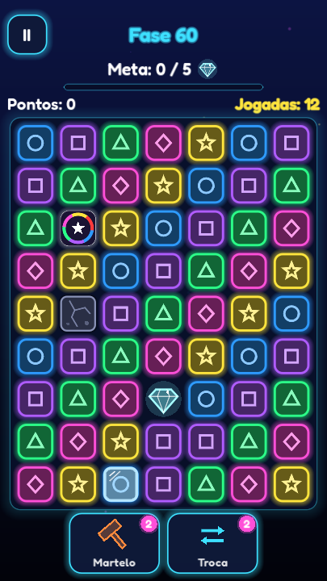
  
  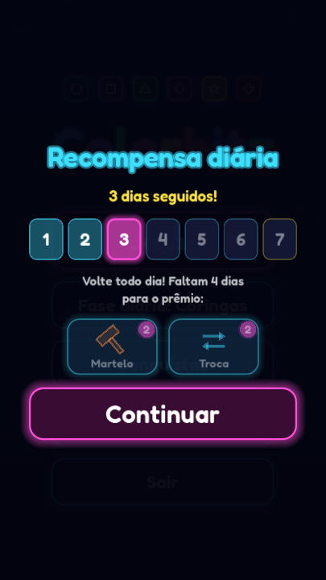
  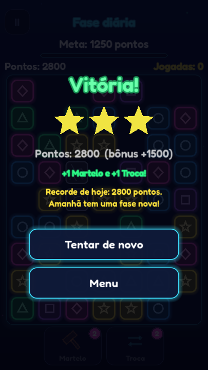
  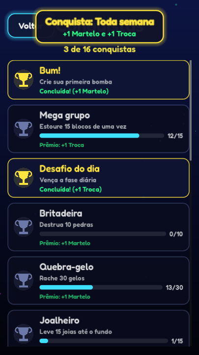
  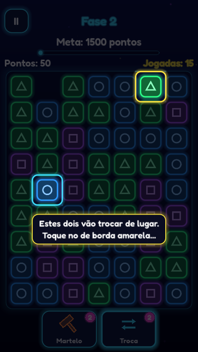
  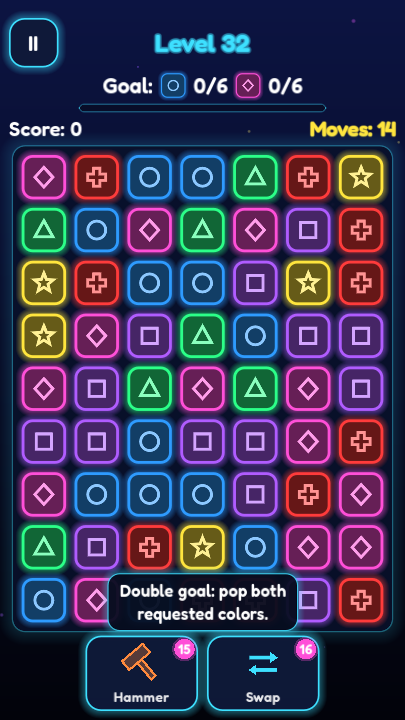
  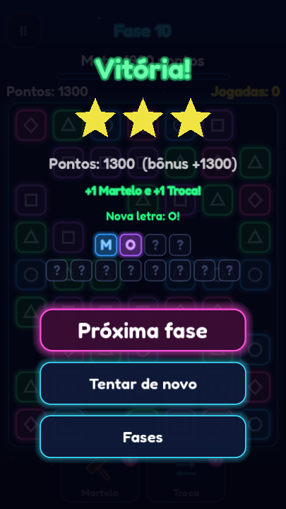
  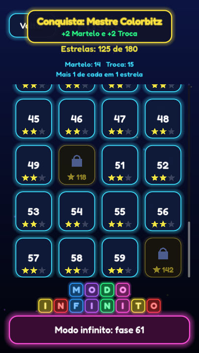
</p>

> Projeto em desenvolvimento: este é o MVP do meu primeiro jogo para Android.

## Como jogar

- Toque em um bloco: ele e todos os vizinhos da mesma cor (cima, baixo, esquerda,
  direita) estouram, se o grupo tiver 2 ou mais blocos.
- Os blocos de cima caem e as colunas vazias se fecham para a esquerda.
- Pontos por jogada: `n × n × 10`, em que `n` é o tamanho do grupo. Grupos maiores valem bem mais,
  e combinações de 6, 9 e 13+ blocos rendem "Ótimo!", "Incrível!" e "Fantástico!".
- Cada fase tem uma meta e um limite de jogadas. Metas: pontuação, estourar X blocos de uma cor,
  **duas cores ao mesmo tempo**, **limpar o tabuleiro** (sobrar no máximo N blocos) e
  **derrubar joias** até o fundo das colunas.
- **Blocos especiais** (entram aos poucos a partir da fase 13, cada um com uma dica na primeira vez):
  - **Pedra**: não estoura nem forma grupo; só sai com a bomba ou o Martelo.
  - **Coringa**: combina com qualquer cor (tocar nele usa a cor vizinha que forma o maior grupo).
  - **Gelo**: prende um bloco colorido até um grupo estourar ao lado (gelo grosso: duas vezes).
  - **Joia**: não estoura; é coletada quando chega ao fundo da coluna.
- **Tabuleiros com formato** (ampulheta, pilares, cantos, janela): os blocos atravessam os buracos ao cair.
- **Bomba**: estourar um grupo grande (8 blocos nas fases de 3–4 cores, 7 com 5 cores e 6 com 6 cores)
  transforma o bloco tocado numa bomba. Tocar nela gasta uma jogada e explode os blocos em volta
  (área 3×3, 50 pontos por bloco, contam para a meta de cor). Bombas atingidas explodem em cadeia.
- **Poderes especiais** (usados quando o jogador quiser, sem gastar jogada):
  - **Martelo**: destrói um bloco à escolha (50 pontos; numa bomba, ela explode).
  - **Troca**: troca dois blocos quaisquer de lugar.
  Começa com 3 de cada e ganha +1 de cada a cada 21 estrelas conquistadas. O saldo fica no save.
  Na primeira fase jogada a partir da 2, um **tutorial guiado** escurece a tela e destaca o botão
  e os blocos que o jogador deve tocar para usar cada poder (usos grátis, só uma vez).
- **Sem jogadas?** A fase não acaba: com poderes, o jogador pode usar o Martelo ou a Troca, ou
  tocar em **Embaralhar** (grátis, só aparece com o tabuleiro travado); sem poderes, o tabuleiro
  é embaralhado automaticamente.
- **Bônus de vitória**: cada jogada que sobrou estoura um bloco e vale +100 pontos.
- **Recompensa diária**: abrir o jogo todo dia avança uma sequência de 7 dias; o 7º dia seguido
  dá 2 Martelos e 2 Trocas. Pular um dia recomeça a sequência.
- **Fase diária**: um tabuleiro por dia, igual para todo mundo (semente pela data no horário de
  Brasília). Cada dia da semana tem um tema (pedras, coringas, gelo, joias, ampulheta, meta dupla,
  limpeza). Pode repetir à vontade; a primeira vitória do dia dá +1 Martelo e +1 Troca e o jogo
  guarda o recorde do dia.
- **Modo infinito**: cada fase múltipla de 5 (5, 10, ..., 60) revela uma letra de
  "MODO INFINITO" (12 letras; "INFINITE MODE" em inglês), mostrada na tela de fases e no
  resultado. Com a palavra completa (fase 60), as fases continuam sem fim a partir da 61, geradas por
  [`scripts/endless.gd`](scripts/endless.gd). Os tipos de meta se revezam (pontos, cor, joias,
  duas cores, formato, limpar) com especiais sorteados; a dificuldade sobe até a fase 121 e
  para num teto justo (~30–70% de vitória no simulador). As estrelas contam para os poderes.
- **Conquistas** (16): por exemplo "criar 25 bombas", "vencer 10 fases sem usar poderes",
  "vencer 7 fases diárias". Cada uma dá poderes e aparece num aviso na hora em que é liberada.
- **Opções**: som, música, vibração, **efeitos reduzidos** (sem tremor de tela nem ondas
  de choque e com menos partículas, para quem é sensível a movimento), **idioma**
  (português ou inglês; começa no idioma do celular) e **apagar progresso** (com confirmação).
- Tocar em um bloco isolado não gasta jogada. Se você ficar parado, o jogo mostra uma dica.
- Vença com jogadas sobrando para ganhar até 3 estrelas: 2 estrelas com 20% das jogadas sobrando e 3 com 40%.
  Cada vitória libera a fase seguinte (60 fases). As fases 10, 20, 30, 40, 50 e 60 são
  **portões**: só abrem com um mínimo de estrelas somadas nas fases anteriores (22, 46, 70, 94, 118 e 142, ou seja, 80% do máximo possível).
- As cores entram aos poucos (3 → 6): azul, roxo, verde, rosa, amarelo e vermelho.
  Cada cor tem também um ícone próprio (○ □ △ ◇ ☆ ✚), para que quem tem daltonismo jogue sem problema.

## Destaques técnicos

- **Lógica separada da interface**: [`scripts/board.gd`](scripts/board.gd) e
  [`scripts/game_session.gd`](scripts/game_session.gd) são classes puras (sem nós
  de cena), então dá para testá-las isoladamente.
- **Fases em dados**: todas as fases ficam em [`data/levels.json`](data/levels.json)
  (geradas a partir da tabela legível em [`tools/levels.sh`](tools/levels.sh)),
  nenhuma é escrita no código.
- **Dificuldade medida, não chutada**: [`tools/balance.gd`](tools/balance.gd) joga cada
  fase centenas de vezes com um jogador "guloso" e um aleatório e mostra a taxa de vitória.
  A curva cai de 100% para cerca de 30% em "dente de serra", aliviando a cada cor nova e após cada portão.
- **Áudio 100% sintetizado** por [`tools/generate_audio.gd`](tools/generate_audio.gd):
  efeitos (pop, explosão de desenho animado, estrelas…) e duas músicas em loop
  (calma nos menus, animada nas fases), sem samples de terceiros.
- **Visual neon leve**: brilho com `StyleBoxFlat` (sombra colorida) e partículas
  `CPUParticles2D` com mistura aditiva, sem pós-processamento, para rodar em celulares modestos.
- **Progresso salvo** em `user://save.json` ([`scripts/progress.gd`](scripts/progress.gd)),
  com gravação atômica (arquivo temporário + rename) e recuperação de save corrompido.
- **Dois idiomas sem duplicar código**: o texto em português é a chave e
  [`data/lang/en.json`](data/lang/en.json) traz o inglês ([`scripts/i18n.gd`](scripts/i18n.gd)).
  Um teste lê o código e falha se algum texto ficar sem tradução ou com `%d` diferente.
- **Testes automatizados** com um executor próprio e leve, rodando em modo headless
  no GitHub Actions a cada push.
- Animações com `Tween`, protegidas contra pausa e reinício no meio da animação.
  O botão "voltar" do Android pausa o jogo e volta entre as telas.

## Rodando o projeto

1. Instale o [Godot 4.7+](https://godotengine.org/download) (versão padrão, não a .NET).
2. Clone o repositório e abra o `project.godot` no editor.
3. Pressione **F5**.

### Testes

```bash
godot --headless --path . --import
godot --headless --path . -s tests/run_tests.gd
```

### Teste de fumaça da interface (gera as imagens de `docs/`)

Percorre todas as telas, simula toques e efeitos e testa pausar e reiniciar durante
uma animação. Não altera o seu save.

```bash
godot --path . -s tools/screenshot.gd
```

### Simulador de dificuldade

```bash
godot --headless --path . -s tools/balance.gd -- 300
godot --headless --path . -s tools/balance.gd -- 300 daily     # modelos da fase diária
godot --headless --path . -s tools/balance.gd -- 200 endless   # modo infinito (início e teto)
```

### Regerar os sons

```bash
godot --headless --path . -s tools/generate_audio.gd
```

### APK de teste para Android

Precisa dos modelos de exportação do Godot 4.7.2, de um JDK 17 (o do Android Studio serve)
e do Android SDK, configurados em *Editor → Configurações do Editor → Exportar → Android*.

```bash
godot --headless --path . --export-debug Android build/colorbitz-debug.apk
adb install -r build/colorbitz-debug.apk   # celular ligado no USB com depuração ativada
```

## Estrutura

```
assets/    tema, fonte e áudio gerado
data/      fases (levels.json)
docs/      imagens do README
scenes/    cenas: menu, seleção de fases, conquistas, opções e jogo
scripts/   lógica pura (board, game_session, progress, level_loader, daily, endless,
           achievements, i18n),
           autoloads GameState e Audio, tela de jogo (game_view) e efeitos (fx)
scripts/ui telas (menu, fases, conquistas, opções) e componentes da tela de jogo:
           game_hud, power_bar, board_fx, tip_balloon, pause_menu, result_panel,
           power_tutorial
tests/     testes da lógica e executor
tools/     teste de fumaça, simulador de dificuldade e gerador de áudio
```

## Roteiro

- [x] **Semana 1**: tabuleiro, remoção de grupos, gravidade, pontuação e testes
- [x] **Semana 2**: menu, seleção de fases, pausa, resultado, 30 fases em JSON e progresso salvo
- [x] **Semana 3**: visual neon, partículas, combos, vibração, sons, músicas e fases rebalanceadas
- [x] **Extras**: poderes, blocos especiais, novas metas, tabuleiros com formato,
      recompensa e fase diária, conquistas
- [x] Teste em celular Android real
- [x] **Antes da loja**: componentes da tela de jogo, inglês, efeitos reduzidos, apagar
      progresso e política de privacidade
- [ ] **Semana 4**: anúncios e publicação na Google Play (teste fechado)

## Privacidade

O jogo não coleta dados: veja a [política de privacidade](PRIVACY.md).

## Créditos e licenças

- Código e áudio: licença [MIT](LICENSE).
- Fonte [Fredoka](https://github.com/hafontia/Fredoka-One): SIL Open Font License 1.1
  ([`assets/fonts/OFL.txt`](assets/fonts/OFL.txt)).
