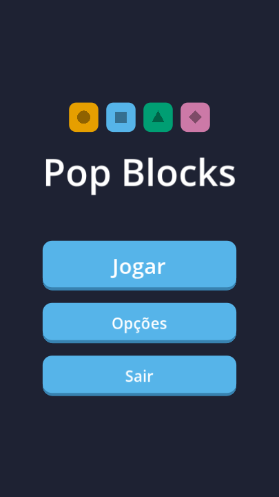
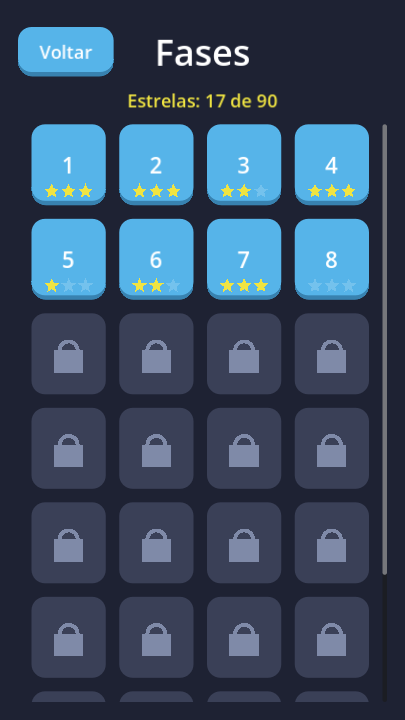
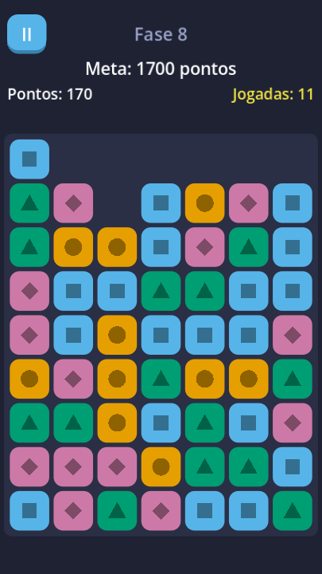
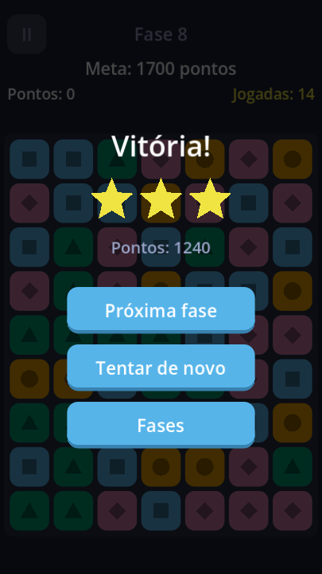

# Pop Blocks

[](https://github.com/matheusmontagner8/pop-blocks/actions/workflows/tests.yml)

Puzzle casual para celular feito em **Godot 4** com **GDScript**. Toque em grupos
de blocos da mesma cor para removê-los e cumpra a meta da fase antes de acabarem
as jogadas.

<p align="center">
  
  
  
  
</p>

> Projeto em desenvolvimento: este é o MVP do meu primeiro jogo para Android.
> O nome "Pop Blocks" é provisório.

## Como jogar

- Toque em um bloco: ele e todos os vizinhos da mesma cor (cima, baixo, esquerda,
  direita) somem, se o grupo tiver 2 ou mais blocos.
- Os blocos de cima caem e as colunas vazias se fecham para a esquerda.
- Pontos por jogada: `n × n × 10`, em que `n` é o tamanho do grupo. Grupos maiores valem bem mais.
- Cada fase tem uma meta (pontuação ou "remover X blocos de uma cor") e um limite de jogadas.
- Tocar em um bloco isolado não gasta jogada.
- Vença com jogadas sobrando para ganhar até 3 estrelas: 2 estrelas com 20% das jogadas sobrando e 3 com 40%.
  Cada vitória libera a fase seguinte (30 fases).
- Cada cor tem também um ícone próprio (●, ■, ▲, ◆…), para que quem tem daltonismo jogue sem problema.

## Destaques técnicos

- **Lógica separada da interface**: [`scripts/board.gd`](scripts/board.gd) e
  [`scripts/game_session.gd`](scripts/game_session.gd) são classes puras (sem nós
  de cena), então dá para testá-las isoladamente.
- **Fases em dados**: todas as fases ficam em [`data/levels.json`](data/levels.json),
  nenhuma é escrita no código.
- **Dificuldade medida, não chutada**: [`tools/balance.gd`](tools/balance.gd) joga cada
  fase centenas de vezes com um jogador "guloso" e um aleatório e mostra a taxa de
  vitória. A curva vai de 100% nas primeiras fases a cerca de 45% (guloso) nas últimas.
- **Progresso salvo** em `user://save.json` ([`scripts/progress.gd`](scripts/progress.gd)),
  com gravação atômica (arquivo temporário + rename) e recuperação de save corrompido.
- **Testes automatizados** com um executor próprio e leve, rodando em modo headless
  no GitHub Actions a cada push.
- Animações com `Tween`, protegidas contra pausa e reinício no meio da animação.
  O botão "voltar" do Android pausa o jogo e volta entre as telas.

## Rodando o projeto

1. Instale o [Godot 4.7+](https://godotengine.org/download) (versão padrão, não a .NET).
2. Clone o repositório e abra o `project.godot` no editor.
3. Pressione **F5**.

### Testes

```bash
godot --headless --path . --import
godot --headless --path . -s tests/run_tests.gd
```

### Teste de fumaça da interface (gera as imagens de `docs/`)

Percorre todas as telas, simula toques e testa pausar e reiniciar durante uma animação.
Não altera o seu save.

```bash
godot --path . -s tools/screenshot.gd
```

### Simulador de dificuldade

```bash
godot --headless --path . -s tools/balance.gd -- 300
```

## Estrutura

```
data/      fases (levels.json)
docs/      imagens do README
scenes/    cenas: menu, seleção de fases, opções e jogo
scripts/   lógica pura (board, game_session, progress, level_loader),
           autoload GameState e telas (game_view, ui/)
tests/     testes da lógica e executor
tools/     teste de fumaça/capturas e simulador de dificuldade
```

## Roteiro

- [x] **Semana 1**: tabuleiro, remoção de grupos, gravidade, pontuação e testes
- [x] **Semana 2**: menu, seleção de fases, pausa, resultado, 30 fases em JSON e progresso salvo
- [ ] **Semana 3**: arte, sons, música e as 30 fases balanceadas
- [ ] **Semana 4**: anúncios e publicação na Google Play (teste fechado)

## Licença

Código sob a licença [MIT](LICENSE).
